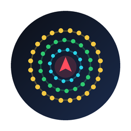
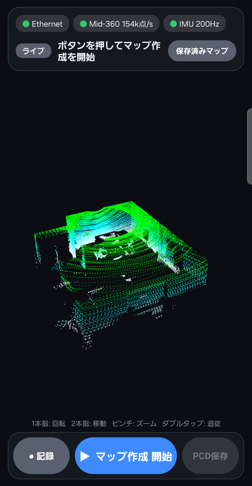
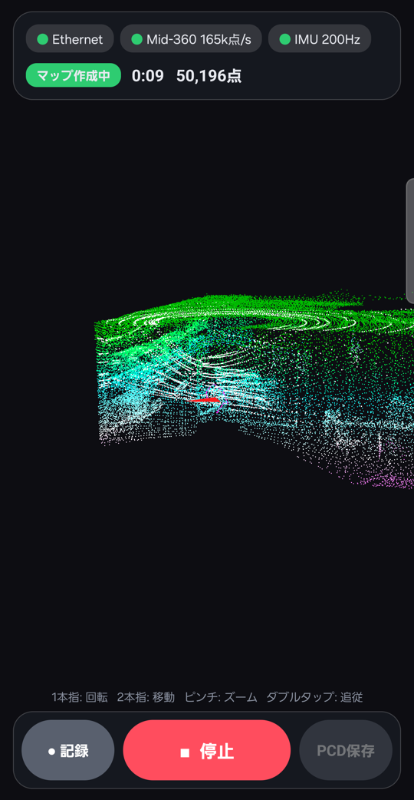
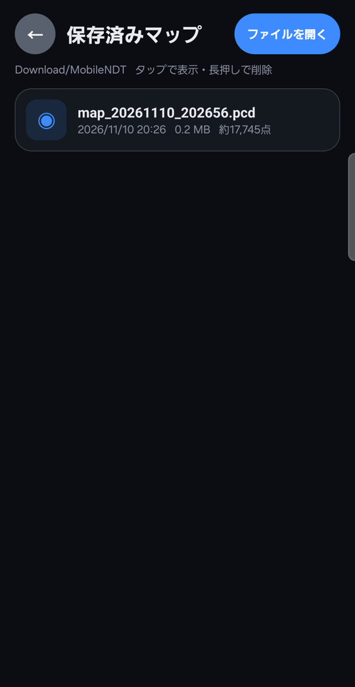

<p align="center"></p>

<h1 align="center">Mobile SLAM</h1>

<p align="center">
Livox Mid-360 を Android スマホに直結して、その場で 3D マップを作るアプリ。<br>
PC も ROS も不要です。
</p>

<p align="center">
<a href="https://github.com/schan-lab/Mobile-SLAM/actions/workflows/build.yml"></a>


</p>

<p align="center">



</p>
<p align="center"><sub>左から：ライブ表示 / マップ作成中 / 保存済みマップ</sub></p>

## できること

- **ライブ表示** — Mid-360 の点群と IMU を USB Ethernet（UDP）で受信して 3D 表示
- **マップ作成（SLAM）** — LiDAR と IMU を組み合わせた LIO で、歩きながら 3D マップを作成
- **PCD 保存・閲覧** — 作ったマップを PCD ファイルで保存し、アプリ内のビューアで確認
- **自己位置推定** — 保存したマップに対して NDT で現在位置を推定。初期位置は地図をタッチして指定でき、省略すれば自動で探索
- **生データ記録** — 受信したパケットをそのまま保存（あとで再生・検証する用途）

3D 表示は 1 本指で回転、2 本指で移動、ピンチでズーム、ダブルタップで自分の位置に追従します。

## 必要なもの

| | |
|---|---|
| スマホ | Android 10 以上、arm64。USB Ethernet（有線 LAN）に対応していること |
| LiDAR | Livox Mid-360 |
| 接続 | USB-C の有線 LAN アダプター、Mid-360 の電源（9–27 V） |

開発と動作確認は Galaxy（Android 17）で行っています。

## 使い方

1. **スマホの有線 LAN を固定 IP にする**
   設定 → 接続 → その他の接続設定 → イーサネット で、IP アドレスを `192.168.1.50`、サブネットを `255.255.255.0` にします。
   これは Mid-360 の工場出荷時の送信先です。
2. **Mid-360 をつなぐ**
   スマホに LAN アダプターを挿し、Mid-360 とケーブルでつないで電源を入れます。
   画面上部の `Ethernet`、`Mid-360`、`IMU` が緑になれば受信できています。
3. **マップを作る**
   「マップ作成 開始」を押し、最初の数秒は静止します。その後ゆっくり歩いてください。
   終わったら「停止」→「PCD保存」。ファイルは `Download/MobileNDT/` に入ります。
4. **自己位置推定する**
   モードを「自己位置推定」に切り替えて「マップを選択」。
   必要なら「初期位置を指定」で地図をタッチ（そのままドラッグすると向きも指定）し、開始します。

## インストール

[Actions](https://github.com/schan-lab/Mobile-SLAM/actions/workflows/build.yml) の最新の実行結果から `MobileSLAM-apk` をダウンロードして、中の APK をインストールします。

デバッグ署名の APK なので、ビルドごとに署名が変わります。入れ直すときは先にアンインストールしてください。

## ビルド

```sh
git clone https://github.com/schan-lab/Mobile-SLAM.git
cd Mobile-SLAM
./gradlew assembleDebug
# → app/build/outputs/apk/debug/app-debug.apk
```

JDK 17 以上と Android SDK（Platform 36、NDK 28.2.13676358、CMake 3.22.1）が必要です。

## 中身

```
app/    Android アプリ（Kotlin）と JNI
core/   SLAM 本体（C++17、Eigen のみに依存）
  lio.*           LiDAR-IMU オドメトリ（反復誤差状態カルマンフィルタ）
  ndt.*           NDT による地図照合
  voxel_map.hpp   ボクセル地図
  livox_packet.hpp  Mid-360 のパケット解析
third_party/eigen   Eigen 3.4.0（ヘッダーのみ）
```

- LIO は FAST-LIO（W. Xu, F. Zhang, RA-L 2021）の定式化に沿った独自実装です。FAST-LIO のコードは含みません。
- Mid-360 との通信も Livox SDK を使わず、公開されているプロトコルを独自に実装しています。

## ライセンス

[MIT License](LICENSE)。自由に使えますが、無保証です。

同梱・利用している第三者ソフトウェアのライセンスは [THIRD_PARTY_NOTICES.md](THIRD_PARTY_NOTICES.md) を見てください。
